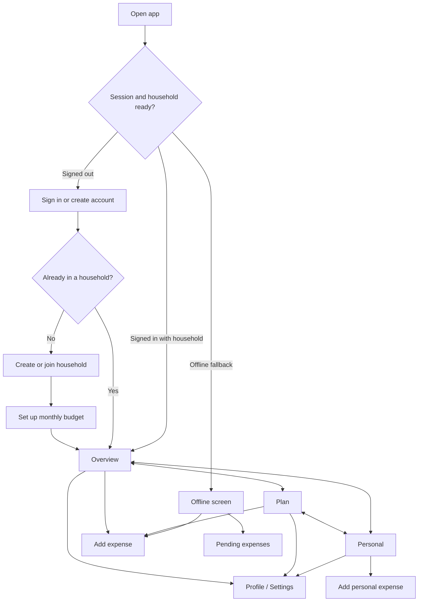
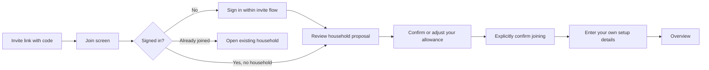
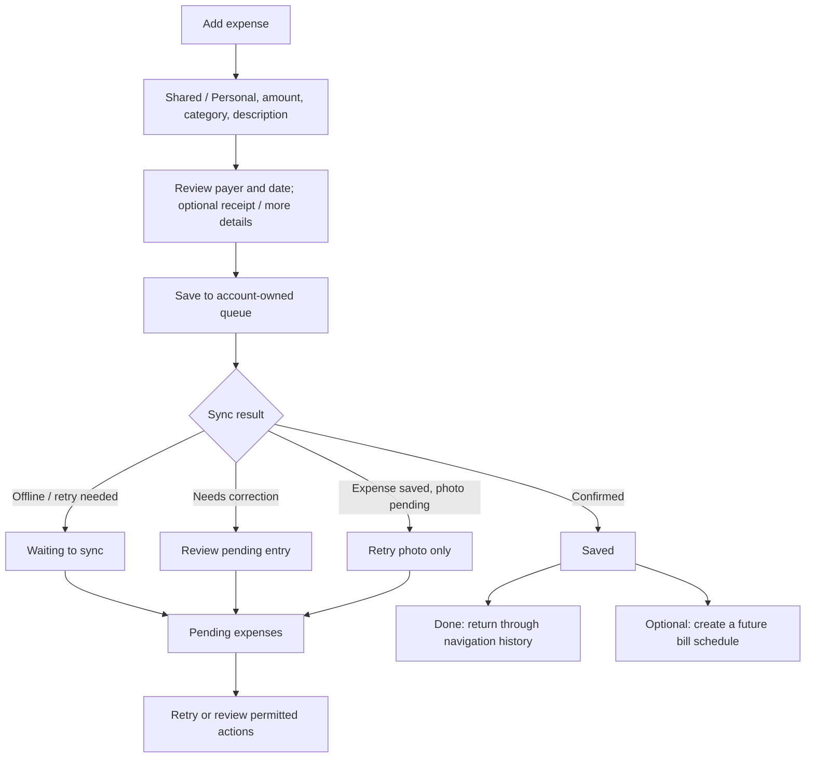
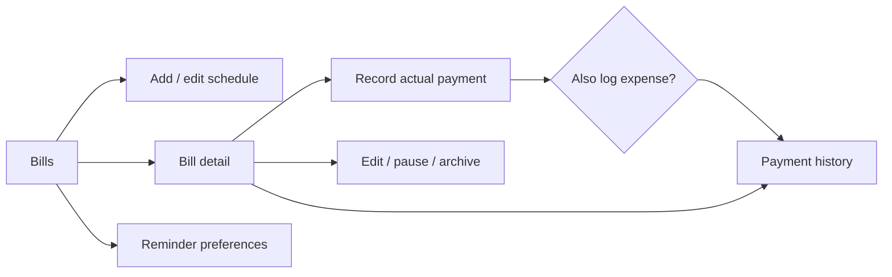
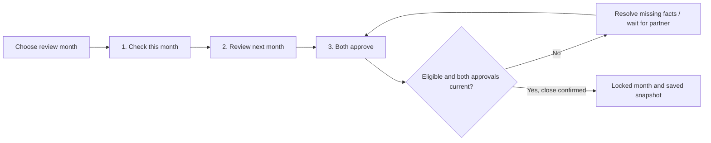

# Couple Goals — app flow

Reviewed 1 November 2026 against the current local code. This describes the **implemented flow**, including unfinished parts of the redesign. See [PLAN.md](PLAN.md) for the target and [the page-by-page review](docs/redesign/REVIEW-2026-11-01.md) for remaining work.

## The app at a glance

**Overview** answers “How are we doing?” **Plan** holds household budgeting tasks. **Personal** holds your own allowance and private spending. The profile/gear button opens Settings. Swipe left across the main screen to move Overview → Plan → Personal, or right to go back. Swipes stop at either end; tab buttons remain available. Vertical scrolling and screen-edge gestures are reserved for their usual actions.

This diagram shows the normal entry journey, not a forced redirect on every launch. Authorized deep links may open their destination. A missing Supabase configuration opens the developer Setup screen (`/setup`). Session/household loading waits; a failed household load offers retry instead of inventing a zero balance. Offline logging requires a remembered account and cached household/catalogue; it does not grant online access.

## First use: one partner starts

1. **Sign in / create account** (`/sign-in`). Account creation may require email confirmation depending on the authentication configuration. Password recovery is still a backlog item, not an available flow.
2. **Create a household** (`/household`): enter the household details, currency, timezone and your display name. The same screen also offers joining by code.
3. **Budget setup** (`/budget`) has four saved steps: your income and split → allowances → shared recurring costs → your income sources/paydays.
4. **Save and continue**, or finish later. Optional payday setup can be deferred. Finish/defer returns to Overview. Resume through Overview's setup prompt, Plan → Budget setup or Settings → Our budget.
5. **Invite your partner** through the invite card when no partner has joined. The proposal is a budget agreement, not a money transfer. Do not substitute guessed partner income or payday details.

Budget setup remains accessible after completion for review/editing. Household membership is the main app access gate; completing every setup step is not a prerequisite for entering the tabs.

## Joining a partner

The URL is `/join?code=…`. The route preserves the code through sign-in, shows a review before joining and returns to `/budget` after success. Offline joining asks the user to reconnect. An existing household member is offered their current household; opening a link does not silently switch membership. The launch-invites migration is still recorded as awaiting deployment; this review did not check the hosted database.

## Everyday navigation

| Starting point | Action | Destination |
| --- | --- | --- |
| Overview `/` | View budget | Spending budget `/shared-budget` |
| Overview | Upcoming bill | Bill detail `/payment-detail?id=…` |
| Overview | See all bills | Bills `/payments` |
| Overview | Recent shared transaction | Conversation `/expense-thread?id=…` |
| Overview | See all activity | Shared expense list `/expenses` |
| Plan `/plan` | Spending budget | `/shared-budget` |
| Plan | Bills | `/payments` |
| Plan | Savings goals | `/goals` |
| Plan | Contributions & income | Your own income `/income` |
| Plan | Cash forecast | `/cash-flow` |
| Plan | Monthly review | `/money-date` |
| Plan | Balance check | `/reconciliation` |
| Plan | More tools | `/boosters`, `/categories`, `/budget` |
| Personal `/private-space` | See all transactions | `/expenses?visibility=private` |
| Personal | Transaction row | `/expense-category?id=…&visibility=private` |
| Personal | See all bills / add bill | `/payments?visibility=private` / `/payment?visibility=private` |
| Personal | Your income / review allowance | `/income` / `/budget` |
| Any main tab | Profile or gear | `/settings` |

Plan also displays both partners' permitted allowance aggregates. It does not display their private purchases or income-source details. Bills opened from Plan currently defaults to **all permitted spaces**, not shared-only. Contributions & income is an entry to the signed-in person's sources; it is not a partner-income browser.

## Add an expense and handle sync

- `/quick-log` is a sheet. Personal's launcher passes `space=private`; elsewhere the form uses its validated last choice or Shared. The scope is visible before saving.
- The full-width action is on Overview, Plan, Personal and Spending budget. Other permitted screens currently show a floating action; this is a review concern on busy forms.
- More details contains advanced entry options. Saving an expense is distinct from creating a recurring schedule afterward (`/payment?fromExpense=…&visibility=…`).
- The current form shows a result screen; **Done** returns through history. It does not automatically dismiss immediately after every save.
- `/pending-logs` shows queued/blocked/receipt-pending status. Blocked entries without a recorded result may be edited through `/quick-log?edit=…` or discarded. Receipt recovery must not log the expense again.
- Expense classification (`/expense-category`) opens a receipt through `/receipt?transactionId=…&visibility=…`.

## Bills

Plan → Bills or Personal → Your bills → select a schedule → review expected date/window, amount, payer and status.

Routes: `/payments` → `/payment`, `/payment-detail?id=…`, `/payment-history`; detail → `/payment-paid?id=…`. Recording payment can atomically create an expense and then opens payment history. Editing a schedule returns to the Bills list. Status changes retain payment history; deletion requires its confirmation UI. Recording a payment does not move bank money.

**Current navigation gap:** several Cancel/Back buttons replace the screen with `/payments`, losing the original Personal filter/context. See the redesign review before changing return routes.

## Spending plan, categories and transactions

Spending budget shows the category wheel, recorded shared income/spending/net and category plan/spent/remaining. Category selection highlights chart data; it does not currently open a category-filtered transaction screen.

| Task | Flow |
| --- | --- |
| Review spending | Spending budget → See all → `/expenses?visibility=shared` |
| Edit monthly agreement | Spending budget → Review our budget → `/budget` |
| Assign planned costs | Spending budget → Assign planned costs → `/budget-categories` |
| Manage category names/order/archive | Plan, Settings or Spending budget → `/categories` → `/category?id=…` |
| Create a category | `/categories` → `/category?visibility=shared` or `private` |
| Reclassify an expense | `/expenses` → `/expense-category?id=…&visibility=…` |
| Discuss shared spending | Shared expense → `/expense-thread?id=…` → comments/reactions |
| Agree who contributes | Shared expense or conversation → `/bill-split?id=…` |

A bill split records agreed contributions separately from the actual payer; it does not settle a debt or charge an allowance. Private expenses do not have shared conversations. Category archival can require reassignment; descriptive edits do not silently rewrite recorded money or dates.

## Income and forecast

Plan → Contributions & income, or Personal → Your income, opens `/income`.

- Source → `/income-entry?source=…`: configure the shared contribution and delay for your source.
- Add income → `/income-entry`; existing occurrence → `/income-entry?id=…`: record expected/received/dismissed status and explicitly approved shared contribution.
- Save returns to `/income`. Its existing bottom Back button opens `/cash-flow`, even when entered from Plan or Personal; this is a known flow inconsistency.

Plan → Cash forecast (`/cash-flow`) shows the recorded balance, expected commitments and calendar. Select a date to review its items; inspect low-balance warnings and unknown amounts.

| Forecast action | Screen |
| --- | --- |
| Record balance / configure forecast | `/cash-flow-setup` |
| Associate planned costs with categories | Setup's budget links or `/budget-categories` |
| Correct/dismiss an eligible expected item | `/forecast-edit?item=…` |
| Add/edit a forecast-only goal reservation | `/forecast-goal` or `/forecast-goal?id=…` |
| Review actual savings goals | `/goals` |

Forecast-only reservations and real savings goals are different workflows. Corrections affect expectations; they must not silently change recorded bank cash, original schedules or private source details.

## Goals, gifts and boosters

Plan → Savings goals (`/goals`) → create (`/goal-edit`) or open (`/goal?id=…`). Sinking funds use the same editor with `kind=sinking`, then the same detail/history flow.

On a goal, review and confirm contributions, own-allowance gifts and eligible reversals. These actions reserve existing shared money; they do not execute transfers. Gifts debit only the giver's allowance under the existing rules. Goal editing saves back to its detail. Cancellation currently goes to the goal list.

**Leftover Booster** (`/boosters`), accessible from Goals and Plan, works as follows:

1. Set an explicit repeating weekly category limit, beginning on a future Monday.
2. After a completed week, review synced spending and available leftover.
3. Choose a goal and amount, review, then confirm the earmark.

It does **not** add money to a category for one week. The Plan subtitle currently says that and is tracked as misleading copy in the review. Weekly limits are separate from the monthly plan.

## Balance check and Monthly review

**Balance check** (`/reconciliation`) can be opened separately from Plan. Record an observed closing balance → compare against confirmed shared contributions/transactions → review any difference. A missing expense can be logged; a shortfall allocation requires the affected partners' explicit approvals. A reviewed surplus can be retained through the existing correction flow. Historical checks remain available.

**Monthly review** (`/money-date`) is the joint month-close flow:

Stage 1 covers wins, goals and closing-balance reconciliation. Stage 2 covers commitments, forecast, optional one-month split changes and savings releases. Stage 3 shows exact reviewed facts and approvals. Only eligible completed months with the required recorded plan can close. Changed facts require renewed review; private purchase detail is not exposed.

**Finish later / Close** returns through history, falling back to Plan when there is none. Back inside later stages goes to the preceding stage. Saved financial drafts/approvals persist, but the screen currently starts at stage one on a fresh mount. The guided walkthrough needs a stage-awareness fix; unchanged guide IDs alone do not guarantee the old flow still works.

## Settings, guidance and exceptional paths

Settings (`/settings`) contains household facts, invite card when applicable, budget/categories shortcuts, reminder preferences, Guides, account email and sign-out. Appearance follows system settings; the page does not currently implement a standalone appearance picker.

- `/reminders`: opt-in preferences and supported native device registration. Production worker/Cron/push delivery remains a separate deployment verification.
- `/guides`: replay/resume optional task walkthroughs. Progress belongs to each account and guides do not save financial actions for the user.
- `/offline`: reconnect or use cached expense entry/pending queue. Online-only financial screens are guarded.
- `/setup`: developer configuration information, not household onboarding.
- Failure/empty/loading states are parts of each journey, not separate route files. A missing record should offer recovery; direct links need a reliable way out.

## Financial labels to preserve

| Label | Meaning |
| --- | --- |
| Shared budget remaining | Monthly shared plan minus counted shared spending |
| Your allowance | Your own permitted allowance ledger total; partner sees aggregates only |
| Recorded shared income | Confirmed shared contributions for the displayed period/cutoff |
| Net balance on Spending budget | Recorded shared income minus counted spending; not bank cash |
| Actual shared balance | Explicit observed balance used for reconciliation/forecast anchoring |
| Forecast | Estimated future balance with expected income, bills and reservations |
| Saved toward a goal | Earmarked shared funds, not a transfer confirmation |

## Redesign status and next pass

The route inventory has **40 screens**: 7 with new page layouts, 2 partially adapted, and 31 still needing a dedicated layout/navigation pass. A simple receipt or error page may need only a consistent header and actions, not a complex redesign.

Complete the remaining pages in connected groups: bills → income/forecast → goals/boosters → reconciliation/splits → expense/category details → setup/auth → reminders/guides/offline/receipts. Use the [review checklist](docs/redesign/REVIEW-2026-11-01.md), preserving the existing money, privacy, draft and retry contracts. Native/live acceptance is still open.

Source of truth: [root guards](src/app/_layout.tsx), [route map](docs/redesign/ROUTES.md), [Plan](src/features/plan/plan-screen.tsx), [launcher](src/features/quick-log/launcher.tsx), and the feature files linked in the review. This document does not claim the remaining redesign or bug fixes have been implemented.
